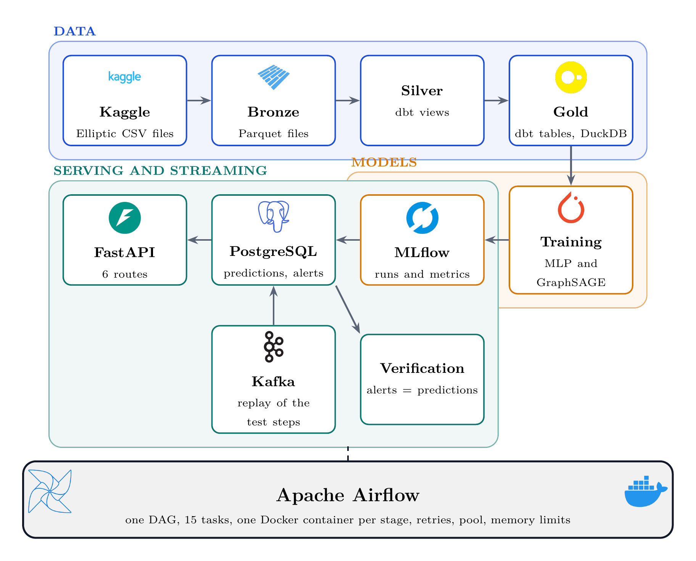
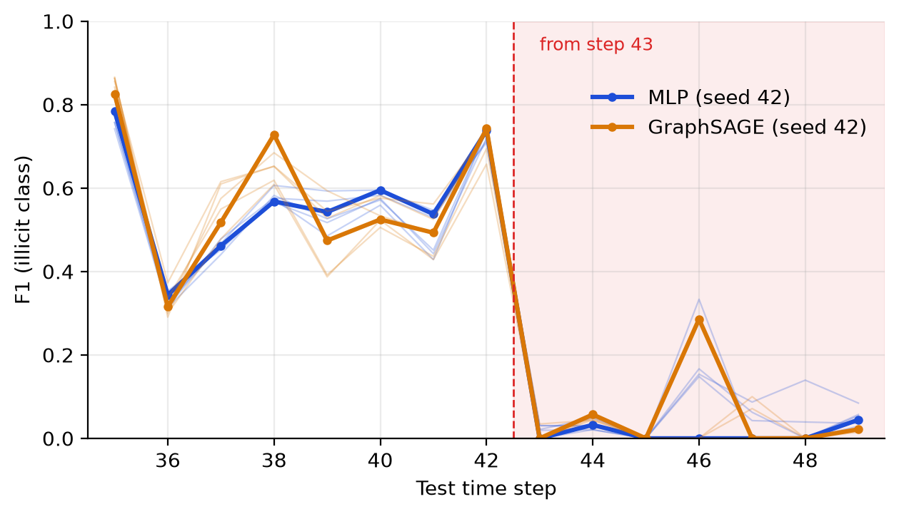
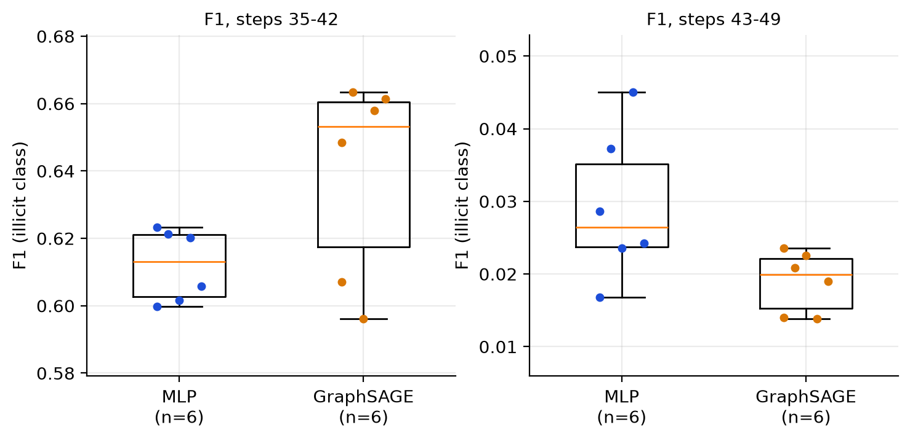
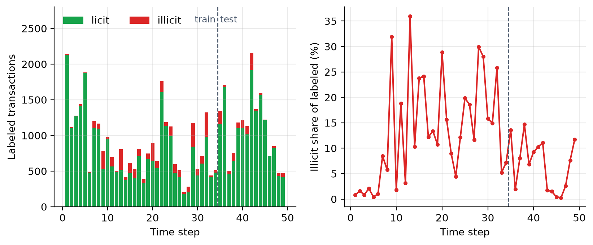

# EllipticPlatform: Illicit Bitcoin Transaction Detection, End to End

An end-to-end **data engineering and machine learning platform** that detects illicit transactions in the [Elliptic Bitcoin Dataset](https://www.kaggle.com/datasets/ellipticco/elliptic-data-set). It covers the whole path from raw files to a monitored service: **medallion data layers (dbt + DuckDB)**, **graph neural network and baseline models (PyTorch)**, **experiment tracking (MLflow)**, **REST API (FastAPI + PostgreSQL)**, **real-time scoring with Apache Kafka** and **orchestration with Apache Airflow**, all running in **Docker**.

The central result is a limit, not just a score: both models reach a moderate F1 on the illicit class in the first test time steps and **collapse from time step 43 onward**. The project measures that drop honestly, with several seeds and a time-based split.



**Full technical documentation (PDF, with equations, tables and diagrams):** [docs/EllipticPlatform_documentation.pdf](docs/EllipticPlatform_documentation.pdf)

## Highlights

- **Data engineering:** raw, bronze (Parquet), silver and gold layers with dbt Core and DuckDB; 29 dbt tests (schema and singular) guard the data, including a leakage guard between train and test.
- **Machine learning:** an MLP baseline and a GraphSAGE (mean aggregator) written in plain PyTorch, trained on a time-based split (time steps 1-34 train, 35-49 test) with a class-weighted loss.
- **MLOps:** every run is tracked in MLflow (parameters, F1 per time step, training time, system metrics); results are compared across 6 random seeds.
- **Serving:** predictions and metrics in PostgreSQL, exposed by a FastAPI service with 6 routes.
- **Streaming:** the test period is replayed through Kafka (3 partitions, manual offset commit, idempotent writes) and an automatic check proves that the streaming alerts equal the batch predictions.
- **Orchestration:** one Airflow DAG with 15 tasks, one Docker container per stage, setup and teardown tasks, retries, a resource pool and memory limits.
- **Quality:** pytest, 10 structural checks of the DAG, dbt tests and ruff.

## Tech Stack

| Area | Tools |
| --- | --- |
| Language | Python, SQL |
| Data transformation | dbt Core, dbt-duckdb, DuckDB, Parquet |
| Machine learning | PyTorch (MLP, GraphSAGE), scikit-learn style metrics |
| Experiment tracking | MLflow |
| Serving | FastAPI, Pydantic, PostgreSQL |
| Streaming | Apache Kafka (KRaft) |
| Orchestration | Apache Airflow (DockerOperator) |
| Infrastructure | Docker, Docker Compose, uv |
| Quality | pytest, ruff, dbt tests |

## Results

Time-based split: train on time steps 1-34, test on 35-49. Metric: **F1 on the illicit class**, pooled over the time steps shown. Mean and standard deviation over 6 seeds.

| Model | F1, steps 35-42 | F1, steps 43-49 | F1, steps 35-49 |
| --- | --- | --- | --- |
| MLP | 0.612 ± 0.011 | 0.029 ± 0.010 | 0.526 ± 0.010 |
| GraphSAGE | 0.639 ± 0.030 | 0.019 ± 0.004 | 0.553 ± 0.030 |



**What the numbers say:**

- GraphSAGE is ahead by about 0.03 in pooled F1, roughly one standard deviation of its own seed spread, so the advantage of using the graph is suggestive and not conclusive.
- Both models fall close to zero from time step 43. The drop is far larger than the difference between the models. The dataset authors report the same behavior; this project measures it and does not claim to explain it.
- GraphSAGE trains about four times slower than the MLP on CPU (258 s versus 65 s for seed 42).





## Dataset and License

The data is the Elliptic Bitcoin Dataset (203,769 transactions, 234,355 edges, 49 time steps; 4,545 illicit and 42,019 licit transactions, the rest unlabeled), from Weber et al., *Anti-money laundering in Bitcoin: experimenting with graph convolutional networks for financial forensics*, KDD Workshop on Anomaly Detection in Finance, 2019.

It is published under **CC BY-NC-ND 4.0**, so this repository does **not** contain the data: you download it from Kaggle with your own token. The tables and figures in this repository contain only aggregates.

## Quick Start

**Requirements:** Docker with Docker Compose, and a free [Kaggle](https://www.kaggle.com) account with an API token. Nothing else is installed on the host; every command runs in a container. The project was developed on a machine with 11 GiB of RAM and 10 CPU cores.

```bash
git clone <this-repository>
cd EllipticPlatform
cp .env.example .env   # then fill in the values; the comments in the file say how
```

### Option A: run the whole pipeline with Airflow

```bash
docker compose --profile orchestrate up -d
```

Open the Airflow UI at http://localhost:8080 (user `admin`; Airflow generates the password in `airflow/config/simple_auth_passwords.json`) and trigger the DAG `elliptic_pipeline`. It runs the 15 tasks in order: ingestion, bronze, silver, gold, both trainings, predictions to PostgreSQL, the Kafka replay and its verification. PostgreSQL and Kafka are started and stopped by the DAG itself.

### Option B: run the stages by hand

```bash
# 1. Data: raw -> bronze -> silver -> gold
docker compose run --rm dev uv run python src/ingest_raw.py
docker compose run --rm dev uv run python src/build_bronze.py
docker compose run --rm dev uv run dbt build --select path:models/silver --project-dir transform --profiles-dir transform
docker compose run --rm dev uv run dbt build --select path:models/gold --project-dir transform --profiles-dir transform

# 2. Train both models, tracked in MLflow
docker compose run --rm dev uv run python src/train.py mlp --log
docker compose run --rm dev uv run python src/train.py sage --log

# 3. Serve: predictions to PostgreSQL, then the API
docker compose --profile api up -d postgres
docker compose run --rm dev uv run python src/write_predictions.py
docker compose --profile api up -d            # API on http://127.0.0.1:8001

# 4. Streaming replay with Kafka
docker compose --profile stream up -d kafka
docker compose run --rm dev uv run python src/producer.py --delay 0.5
docker compose run --rm dev uv run python src/consumer.py --run mlp-seed42 --group demo --idle 60
docker compose run --rm dev uv run python src/verify_replay.py --run mlp-seed42

# 5. Experiment tracking UI
docker compose --profile track up -d          # MLflow on http://127.0.0.1:5000
```

Docker Compose profiles keep each module separate: `explore` (Jupyter), `track` (MLflow), `api` (PostgreSQL and the API), `stream` (Kafka) and `orchestrate` (Airflow). Everything listens on `127.0.0.1` only.

## Project Structure

```text
EllipticPlatform/
├── src/             ingestion, bronze build, models, training, metrics, API, Kafka producer and consumer
├── transform/       dbt project: silver and gold models, singular tests
├── sql/             PostgreSQL schema and alerts query
├── airflow/dags/    the elliptic_pipeline DAG
├── tests/           pytest suite and the DAG structure checks
├── notebooks/       exploratory data analysis
├── docs/            technical documentation (PDF) and figures
├── compose.yaml     all services, grouped in profiles
├── Dockerfile       the image shared by every stage
└── pyproject.toml   dependencies, locked with uv (uv.lock)
```

## API

FastAPI with Pydantic response models, served on http://127.0.0.1:8001. Interactive documentation is available at `/docs`.

| Route | Returns |
| --- | --- |
| `GET /health` | service and database status |
| `GET /runs` | the runs available |
| `GET /transactions/{tx_id}` | score and prediction of one transaction |
| `GET /time-steps/{t}/alerts` | alerts of a time step from the batch predictions |
| `GET /metrics/by-time-step` | precision, recall and F1 by time step |
| `GET /stream/time-steps/{t}/alerts` | alerts of a time step from the Kafka replay |

Routes that return predictions take a `run_id` parameter, and the alert routes accept `limit` (1 to 100, default 20).

## Tests and Quality

```bash
docker compose run --rm dev uv run pytest
docker compose run --rm dev uv run python tests/check_dag.py
docker compose run --rm dev uv run ruff check .
```

`pytest` covers the bronze build, gold loading, metrics, models, tracking, the API, the streaming consumer and the predictions writer. `check_dag.py` runs 10 structural checks on the DAG without executing it. The dbt build runs 18 tests in silver and 11 in gold, and the replay verification proves that the streaming alerts equal the batch predictions.

## How It Works

### Data layers

| Layer | Content |
| --- | --- |
| Raw | the Kaggle files untouched, with a manifest (source, license, size and sha256 of each file) |
| Bronze | the same tables as Parquet files |
| Silver | dbt views with typed columns and the label recoded (illicit, licit, unknown) |
| Gold | dbt tables ready for modeling: one row per transaction with its split and in and out degrees, and one row per edge |

### Models and evaluation

- **Split by time:** training on time steps 1-34 and testing on 35-49, so the model is always scored on the future of what it learned from. The dbt test `no_cross_split_edges` guarantees that no edge links a training node to a test node.
- **Models:** an MLP that ignores the graph and a GraphSAGE with the mean aggregator, in plain PyTorch. Both take 167 inputs (165 dataset features plus the in and out degree).
- **Loss:** binary cross-entropy with the positive class weighted by the class ratio of the training set. A transaction is predicted illicit when its score is above 0.5.
- **Metric:** F1 on the illicit class, pooled and per time step. Accuracy is not used, because a model that predicts only licit would score high and detect nothing.

### Streaming with Kafka

The test transactions are replayed as a stream through a topic with 3 partitions, keyed by time step. The consumer scores each batch and writes the alerts to PostgreSQL. Offsets are committed manually, only after the batch is written, and inserts are idempotent, so a crash re-reads a batch without duplicating alerts. `verify_replay.py` then checks that the set of streaming alerts equals the set of batch predictions with `predicted = 1`, and fails on any difference.

### Orchestration with Airflow

The DAG `elliptic_pipeline` has 15 tasks, and every stage runs in its own Docker container through the `DockerOperator`.

- **Setup and teardown:** PostgreSQL and Kafka are started and stopped by the DAG.
- **Retries:** two retries with a 30-second delay, except the two trainings.
- **Resources:** a pool with one slot for the heavy tasks, a memory limit per container measured from real runs, and explicit thread limits. The only concurrent tasks are the producer and the consumer, so the worst case is 3.5 GiB.
- **Secrets:** passed as private environment variables, never in the rendered task parameters.

## Limitations

- Both models collapse from time step 43; a single temporal cut is not an operational setting, and periodic retraining would be a fairer one.
- There is no separate validation partition; the hyperparameters are fixed in the code, not tuned.
- With few illicit transactions per time step, metrics vary across seeds, so small differences between models should be read against that spread.
- Most nodes are unlabeled and serve only as graph context.
- One Kafka broker, a LocalExecutor and a CPU-only full-batch GraphSAGE are enough for this dataset but would not scale to a real transaction stream.

## Security and Reproducibility

- The Kaggle token lives only in `.env`, and the Airflow configuration and logs stay out of version control.
- The data, the warehouse, the MLflow store and the Airflow files are git-ignored; the dataset license forbids redistributing it.
- Every service listens on `127.0.0.1` only.
- Dependencies are pinned with `uv.lock`, training uses fixed seeds, and the same commands run by hand, in tests and inside Airflow.

## Skills Demonstrated

Data engineering, ELT and medallion architecture, SQL, dbt, DuckDB, graph neural networks, PyTorch, MLOps and experiment tracking, REST API design, event streaming with Kafka, workflow orchestration with Airflow, containerization with Docker, data quality testing, reproducible and secure project setup.

## Author

**Kevin Mota da Costa**: [Portfolio](https://costakevinn.github.io) · [LinkedIn](https://linkedin.com/in/costakevinnn) · [GitHub](https://github.com/costakevinn)
